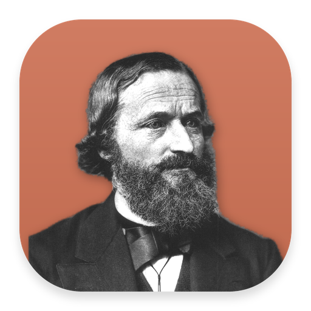
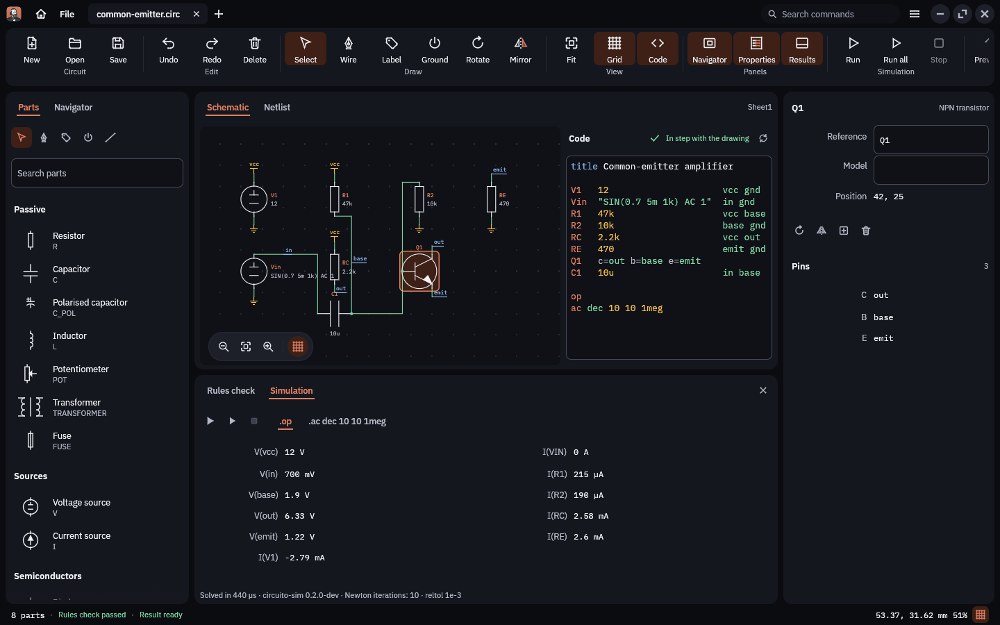
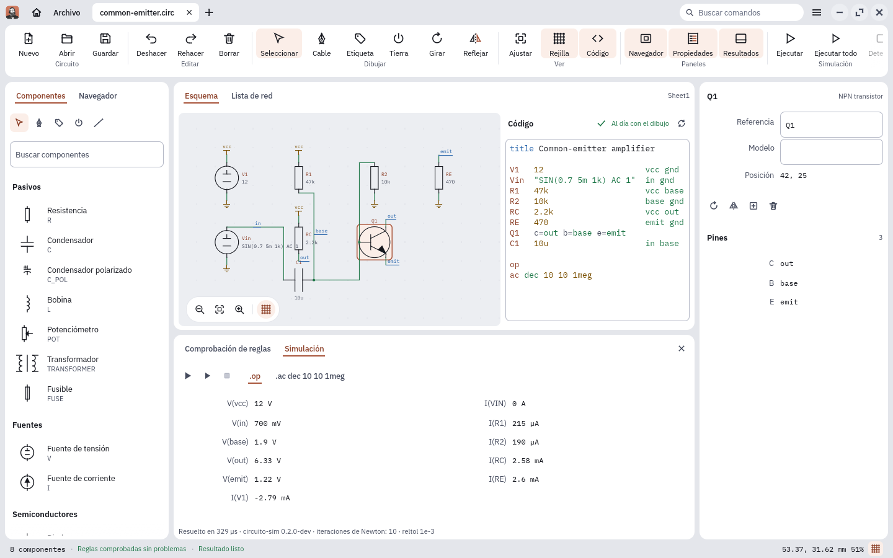
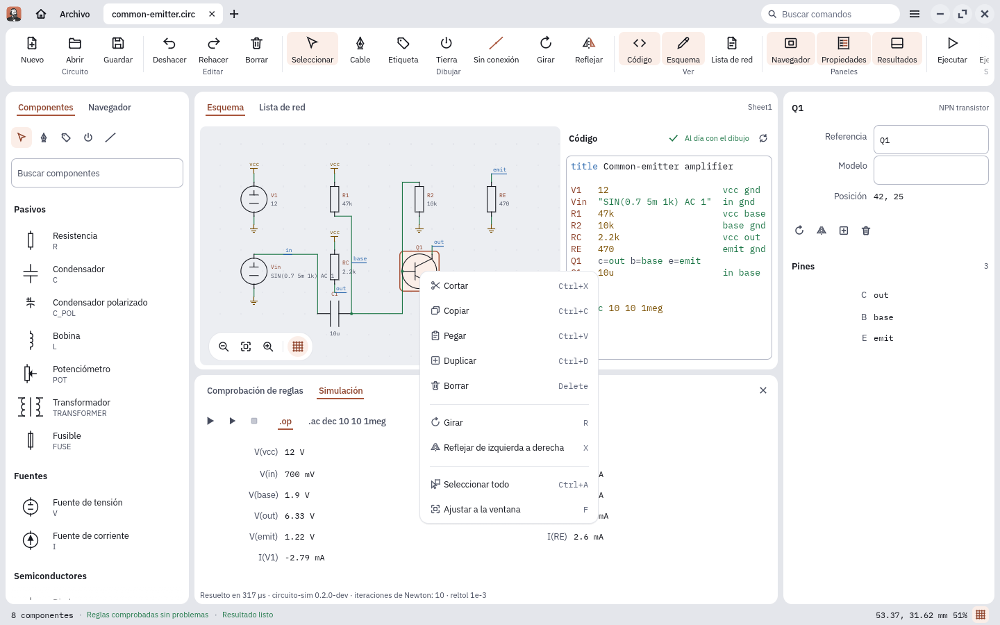

<div align="center">
  <a href="https://getnodalia.com">
    
  </a>
  <br><br>
  
  <h1>Circuito</h1>
  <p><strong>The electronics application of the Nodalia suite.</strong></p>

  <p>
    
    
    
  </p>

  <p>
    <a href="#overview">Overview</a> ·
    <a href="#screenshots">Screenshots</a> ·
    <a href="#what-it-does">What it does</a> ·
    <a href="#download">Download</a> ·
    <a href="#build-and-run">Build</a> ·
    <a href="#command-line">Command line</a> ·
    <a href="#project-status">Status</a> ·
    <a href="#the-nodalia-suite">Suite</a> ·
    <a href="#license">License</a>
  </p>
</div>

<p align="center">
  
</p>

---

## Overview

**Circuito** is the electronics application of [Nodalia](https://getnodalia.com): schematic
capture, circuit simulation, PCB design and manufacturing outputs. It is a native app written in
Rust with engines of its own (no wrapper around SPICE, KiCad or anything else), with no account and
no cloud, and it wears Nodalia Design: rounded islands, the suite's line icons in Circuito's
copper, and the suite's own window controls on Linux.

You draw and edit a circuit with the mouse, or write it as code. The two stay in step: edit the
drawing and the code changes, edit the code and the drawing changes.

> [!IMPORTANT]
> **Circuito is at an early stage.** There is no PCB editor yet, and nothing here is certified or
> fit for safety-critical use. Keep a copy of circuits that matter.

## Screenshots

<table>
<tr>
<td width="50%" valign="top"><p align="center"><sub><b>Light theme, in Spanish.</b> English and Spanish, light and dark.</sub></p></td>
<td width="50%" valign="top"><p align="center"><sub><b>The editor.</b> Select, move, rotate, mirror, copy and paste, with unlimited undo and redo.</sub></p></td>
</tr>
</table>

## What it does

- **A schematic editor.** Drag parts from the list onto the sheet, draw wires that snap to pins and
  to other wires, add net labels, power ports and no-connect flags, and edit references, values and
  models in the properties panel.
- **Circuit code** (`circuito-script`): a short text form of a schematic, one line per part
  (`R1 1k in out`), drawn with automatic placement and routing and written back from a drawing.
  Applying a text to a drawing keeps what you placed. See [`docs/script.md`](docs/script.md).
- **A circuit simulator** (`circuito-sim`): modified nodal analysis with Newton–Raphson, gmin and
  source stepping; DC operating point, AC small-signal and transient analysis. Models: R, C, L,
  mutual inductors, independent and controlled sources, diode, BJT, MOSFET level 1, switch and
  op-amp. Analyses run on a worker thread with progress and cancel, and the results are plotted
  with engineering units.
- **SPICE files** (`circuito-spice`): reads and writes R, C, L, V, I, D, E, G, F, H, K, Q, M and S
  cards, `.model`, `.op`, `.dc`, `.ac` and `.tran`. Unsupported cards and `.include` are errors,
  never skipped.
- **An electrical rules check** (`circuito-erc`): 25 rules with stable codes, listed in the app and
  available as JSON.
- **PCB outputs** (`circuito-pcb`): a board model, an exact-geometry design-rules check, Gerber
  RS-274X/X2, Excellon drill, pick-and-place and BOM CSV.
- **Engineering values** such as `4.7k` and `100n`, source waveforms and a 19-part library
  (`circuito-core`).

What the engines were checked against is written in each crate's README. Simulation results were
compared with analytic solutions and the published model equations, not with another simulator, and
the Gerber and Excellon files were read back by our own readers, not opened in an external viewer.
What does not exist yet is in [`ROADMAP.md`](ROADMAP.md): the PCB editor, hierarchical sheets in
the app, a library of your own parts, `.noise`, `.step` and Monte Carlo, zone fill, autorouting, a
3D board, and PLC and FPGA tools.

## Download

Packages for Linux, macOS and Windows are on the
[releases page](https://github.com/getnodalia/circuito/releases/latest) and at
[getnodalia.com/circuito](https://getnodalia.com/circuito). None is signed with a developer
certificate, so the first start asks you to confirm.

[Nodalia Launcher](https://getnodalia.com/launcher) installs it and keeps it up to date too.

| System | File | Notes |
|---|---|---|
| Linux x86_64 | `circuito-<version>-linux-x86_64.AppImage` | Make it executable and run it. |
| | `.deb`, `.rpm`, `.tar.gz` of the same name | `sudo apt install ./circuito-<version>-linux-x86_64.deb`, `sudo dnf install ./circuito-<version>-linux-x86_64.rpm`, or unpack the tarball. |
| macOS | `circuito-<version>-macos-universal.dmg` | Intel and Apple silicon. Ad hoc signed, not notarized: open the app with right click, Open. |
| Windows x64 | `circuito-<version>-windows-x64.msi` | For your account or for everyone. SmartScreen warns on the first start (More info, Run anyway). |
| | `circuito-<version>-windows-x64-portable.zip` | Unpack anywhere. |

Each package has the desktop app (`circuito-app`) and the `circuito` command. Checksums are in
`SHA256SUMS` (Linux), `SHA256SUMS-macos` and `SHA256SUMS-windows`. The release pipeline is described
in [`docs/release-notes/README.md`](docs/release-notes/README.md) and the packaging scripts are in
[`packaging/`](packaging/).

## Build and run

You need a recent stable Rust toolchain. On Linux, the app also needs `libxkbcommon-x11-0` and
`libegl1` at run time.

```bash
git clone https://github.com/getnodalia/circuito.git
cd circuito
cargo run --release -p circuito-app -- examples/divider.circ
```

The gate that CI runs:

```bash
cargo fmt --all -- --check && cargo clippy --workspace --all-targets --locked -- -D warnings && cargo test --workspace --locked
```

## Command line

`circuito` runs the same engines without the interface: `sim`, `erc`, `netlist`, `drc` and
`gerber`, with table, CSV or JSON output.

```console
$ circuito sim examples/divider.circuito
* .op  [circuito-sim 0.1.0-dev; dc: newton]
V(IN)   1.000000000e1 V
V(OUT)  6.875000000e0 V
$ circuito erc examples/divider.circuito
examples/divider.circuito: 0 error(s), 0 warning(s), 0 note(s)
$ circuito gerber examples/sample-board.circuito-pcb --out out/
```

## Project status

| Area | State |
|---|---|
| Engines (core, SPICE, simulator, rules check, PCB outputs) | Working, checked against analytic solutions and read back by our own readers |
| Schematic editor and circuit code | Working: one sheet at a time |
| PCB editor | Planned |
| App icon | Done: portrait of Gustav Kirchhoff |
| Nodalia interface | Done: Nodalia theme and icons, rounded islands, main menu, Nodalia window controls on Linux |
| Installable packages | Linux, macOS (DMG) and Windows, built by CI for every release |

## App icon

Nodalia app icons are black-and-white portraits of historical figures over the app colour.
Circuito's is Gustav Kirchhoff, whose circuit laws underlie every simulator here. Provenance and
licence are in [`ATTRIBUTION.md`](ATTRIBUTION.md).

## The Nodalia suite

Circuito is one of the applications of [Nodalia](https://getnodalia.com), an independent software
project developed in public by [Daniel Miguel Tejedor](https://danielmigueltejedor.com). It belongs
to the Engineering suite, with Forja, Torno, Vortia, Ábaco and Código.

Contributing and agent rules are in [`AGENTS.md`](AGENTS.md); security is in
[`SECURITY.md`](SECURITY.md).

## License

`MIT OR Apache-2.0`. See [`LICENSE-MIT`](LICENSE-MIT) and [`LICENSE-APACHE`](LICENSE-APACHE).
